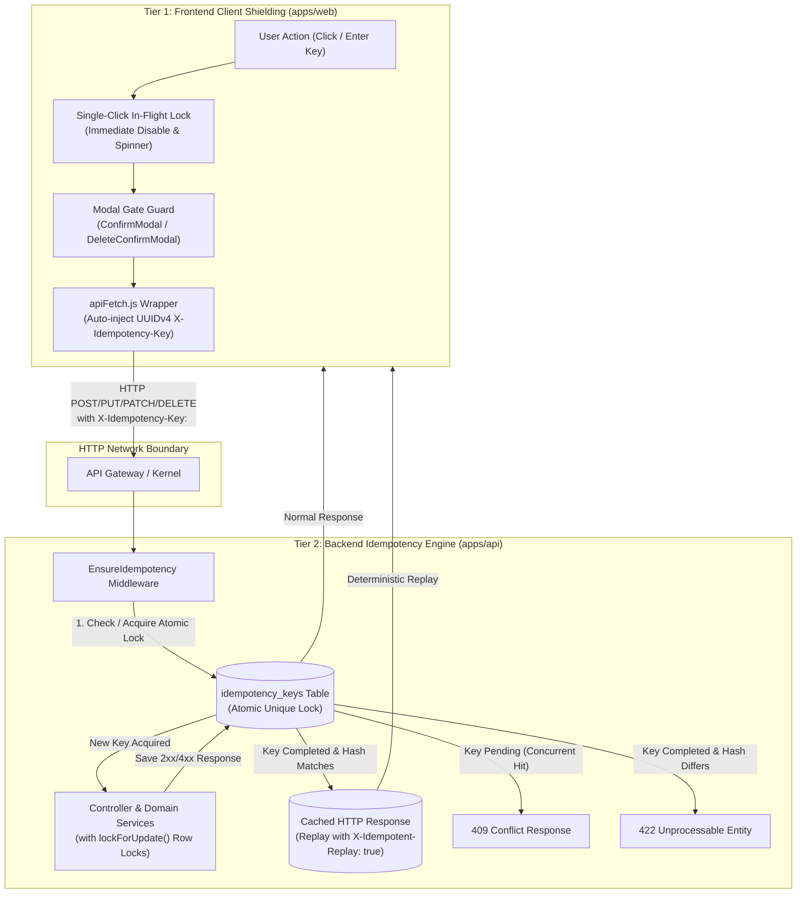

# Idempotency & Duplicate Request Prevention System Design Specification

**Date:** Oct 22, 2026  
**Status:** Approved  
**Author:** SERMS Architecture & Security Council  

---

## 1. Executive Summary & Problem Definition

In an enterprise expense management system, duplicate HTTP requests pose severe financial, operational, and data-integrity hazards. In SERMS, financial disbursements, claims submissions, 3-strike revision reviews, and compliance rule enforcements can be triggered multiple times through:
1. **Accidental Double-Clicks:** Users clicking a primary confirmation button twice before the asynchronous request completes.
2. **Keyboard Rapid-Fire:** Users repeatedly pressing the <kbd>Enter</kbd> key inside password confirmation inputs.
3. **Network Retries & Drops:** Unstable connections causing the client or proxy to retransmit a request when the server-side transaction had already executed.
4. **Concurrent Race Conditions:** Distributed or parallel requests hitting identical database records simultaneously without pessimistic row locks.

A system-wide audit of SERMS revealed:
- **Zero Idempotency Headers:** No client or server inspection of `Idempotency-Key` or `X-Idempotency-Key` headers currently exists.
- **Unshielded Modals:** Root confirmation dialogs ([`ConfirmModal.vue`](file:///c:/Projects/smart-expense-management-system/apps/web/src/components/base/ConfirmModal.vue) and [`DeleteConfirmModal.vue`](file:///c:/Projects/smart-expense-management-system/apps/web/src/components/base/DeleteConfirmModal.vue)) lack immediate click-locking or missing `:loading` bindings from calling parent views.
- **Vulnerable Revision Counters:** Rejection/revision workflows increment strike counters (`$newCount = $currentCount + 1`) without transactional row locks (`lockForUpdate()`), prematurely penalizing employees upon duplicate submissions.
- **Missing Database Constraints:** Pivot tables and disbursement ledgers (e.g. `cash_advance_disbursements`) lack database-level uniqueness constraints against duplicate payouts.

### Scope of Enforcement
Idempotency and duplicate prevention must be implemented across **all mutating requests** (`POST`, `PUT`, `PATCH`, `DELETE`) across the entire SERMS application suite, using a defense-in-depth architecture.

---

## 2. Dual-Defense Architectural Model

The system employs a two-tier defense model ensuring that neither client-side UI glitches nor network packet replays can compromise system state:



---

## 3. Backend Engine Architecture

### 3.1 Database Ledger Schema (`idempotency_keys`)

A dedicated ledger table tracks every mutating request lifecycle:

```sql
CREATE TABLE idempotency_keys (
    id BIGINT UNSIGNED AUTO_INCREMENT PRIMARY KEY,
    user_id BIGINT UNSIGNED NULL,
    idempotency_key VARCHAR(64) NOT NULL,
    request_method VARCHAR(10) NOT NULL,
    request_path VARCHAR(255) NOT NULL,
    request_hash VARCHAR(64) NOT NULL,
    status ENUM('pending', 'completed', 'failed') NOT NULL DEFAULT 'pending',
    response_status INT NULL,
    response_body LONGTEXT NULL,
    response_headers JSON NULL,
    expires_at TIMESTAMP NOT NULL,
    created_at TIMESTAMP NULL,
    updated_at TIMESTAMP NULL,
    CONSTRAINT uniq_user_idempotency_key UNIQUE (user_id, idempotency_key),
    INDEX idx_idempotency_key (idempotency_key),
    INDEX idx_expires_at (expires_at)
);
```

#### Field Specifications:
- `user_id`: Authenticated user ID (nullable for public authentication requests).
- `idempotency_key`: 36-to-64 character token provided via `X-Idempotency-Key` or `Idempotency-Key` header.
- `request_hash`: SHA-256 HMAC of `request_method + '|' + request_path + '|' + canonical_json(request_body)`.
- `status`:
  - `pending`: Lock acquired, request is executing.
  - `completed`: Transaction finished; response status and payload cached for deterministic replay.
  - `failed`: Unhandled exception or 500 error occurred; entry discarded or flagged to allow retry.
- `response_headers`: Stored headers (e.g. `{"Content-Type": ["application/json"]}`).
- `expires_at`: Default retention of 24 hours (`now()->addHours(24)`).

### 3.2 Middleware Execution Logic (`EnsureIdempotency`)

The middleware [`App\Modules\Shared\Http\Middleware\EnsureIdempotency`](file:///c:/Projects/smart-expense-management-system/apps/api/app/Modules/Shared/Http/Middleware) executes on all API routes:

1. **Method Check:** If the request method is safe (`GET`, `HEAD`, `OPTIONS`), pass directly to `$next($request)`.
2. **Key Extraction:** Inspect `X-Idempotency-Key` or `Idempotency-Key` header.
   - If missing on mutating requests (`POST`, `PUT`, `PATCH`, `DELETE`), generate a fallback hash or allow execution with warning, but enforce that client services provide valid UUID keys.
3. **Payload Digest Generation:** Compute canonical SHA-256 hash of the request path and payload.
4. **Atomic Lock Acquisition:**
   - Attempt to query existing record with `lockForUpdate()`.
   - If record exists:
     - If `status === 'completed'`:
       - If `request_hash !== existing->request_hash`, abort with **422 Unprocessable Entity** (`"Idempotency key reused with different request payload"`).
       - If `request_hash === existing->request_hash`, immediately return replayed response with headers and status code, appending header `X-Idempotent-Replay: true`.
     - If `status === 'pending'`:
       - Abort with **409 Conflict** (`"A request with this idempotency key is currently processing. Please wait."`).
   - If record does not exist:
     - Wrap insert in `try / catch (QueryException $e)`.
     - Insert row with `status = 'pending'`, `user_id`, `idempotency_key`, `request_method`, `request_path`, `request_hash`, `expires_at = now()->addHours(24)`.
     - If duplicate key collision occurs during insert race, catch and return **409 Conflict**.
5. **Pipeline Execution & Response Caching:**
   - Proceed with `$response = $next($request)`.
   - If response status is between 200 and 499 (successful or deterministic client error):
     - Update ledger: `status = 'completed'`, `response_status = $response->getStatusCode()`, `response_body = $response->getContent()`, `response_headers = json_encode($filteredHeaders)`.
   - If response status is 500+ or an uncaught exception is thrown:
     - Update `status = 'failed'` or delete the pending key so the user can safely retry once the underlying error is fixed.

### 3.3 Domain Row-Level Locking (`lockForUpdate`)

In addition to idempotency key caching, high-concurrency state transitions must acquire row locks:
1. **Revision Strike Increments:**
   - In `CashAdvanceService::rejectAdvance`, `ReimbursementService::rejectReimbursement`, and `LiquidationController::audit`:
     ```php
     $record = $model::where('id', $id)->lockForUpdate()->firstOrFail();
     $record->revision_count = $record->revision_count + 1;
     $record->save();
     ```
2. **Disbursement Creation:**
   - Enforce database unique constraint on `cash_advance_disbursements.cash_advance_id` and lock the cash advance row during disbursement.
3. **Liquidation Claim Row Locks:**
   - In `LiquidationController::store`, lock parent `CashAdvance` row to verify status is `disbursed` or `partially_liquidated` before attaching new settlements.

---

## 4. Frontend Client Architecture

### 4.1 Universal Key Generation in `apiFetch.js`

Every mutating request (`POST`, `PUT`, `PATCH`, `DELETE`) routed through [`apps/web/src/utils/apiFetch.js`](file:///c:/Projects/smart-expense-management-system/apps/web/src/utils/apiFetch.js) is automatically stamped with an `X-Idempotency-Key` header:

```javascript
const method = (options.method || 'GET').toUpperCase()
const isMutatingMethod = ['POST', 'PUT', 'PATCH', 'DELETE'].includes(method)

if (isMutatingMethod && !headers.has('X-Idempotency-Key')) {
  const customKey = options.idempotencyKey || 
    (typeof crypto !== 'undefined' && crypto.randomUUID ? crypto.randomUUID() : null)
  if (customKey) {
    headers.set('X-Idempotency-Key', customKey)
  }
}
```

- **Sticky Key Pattern for Retries:** Forms that implement manual or automatic retry logic (e.g. `ReimbursementFormView.vue`, `CashAdvanceFormView.vue`) generate an idempotency key at form initialization. If a request times out and the user clicks "Retry", the same key is reused, allowing the backend to replay the cached response if the first attempt actually succeeded. Upon successful completion or form reset, a fresh key is generated.

### 4.2 Modal Shielding & Immediate Click-Lock

1. **[`ConfirmModal.vue`](file:///c:/Projects/smart-expense-management-system/apps/web/src/components/base/ConfirmModal.vue):**
   - Introduce internal `isClicked` reactive flag.
   - On clicking the "Done" / Confirm button, set `isClicked = true` immediately, disabling the button and triggering the spinner before emitting the `confirm` event.
   - Reset `isClicked = false` when `props.isOpen` transitions from `false` to `true`.
   - Update parent usages in `ReimbursementFormView.vue` and `LiquidationsView.vue` to bind `:loading="submitting"`.
2. **[`DeleteConfirmModal.vue`](file:///c:/Projects/smart-expense-management-system/apps/web/src/components/base/DeleteConfirmModal.vue):**
   - Add `isSubmitting` / `loading` prop (default `false`).
   - Bind `:disabled="loading || isSubmitting"` and `:loading="loading || isSubmitting"` on the delete action button.
   - Ignore `@keydown.enter` events if `loading` or `isSubmitting` is active.
3. **[`DecisionConfirmationModal.vue`](file:///c:/Projects/smart-expense-management-system/apps/web/src/components/base/DecisionConfirmationModal.vue):**
   - Add guard inside `handleFinalConfirm`: `if (props.isSubmitting) return;`
   - Prevent duplicate emit if <kbd>Enter</kbd> is pressed repeatedly while in-flight.
4. **[`BaseButton.vue`](file:///c:/Projects/smart-expense-management-system/apps/web/src/components/base/BaseButton.vue):**
   - Retain standard `@click` and remove premature `mousedown` emit conflicts.
   - Ensure `:disabled="loading || disabled"` completely disables DOM click propagation.

---

## 5. Detailed Button & Action Remediation Matrix

All 15 mutating buttons identified in the audit are shielded as follows:

| # | Button / Action | Target Component | Frontend Remediation | Backend Remediation |
|---|---|---|---|---|
| 1 | **Submit Reimbursement Claim** | `ReimbursementFormView.vue` + `ConfirmModal.vue` | Bind `:loading="submitting"`; add immediate click-lock in `ConfirmModal`; add `if (submitting.value) return` guard in `useReimbursementSubmit.js`. | `EnsureIdempotency` middleware caches response; wrap in DB transaction with row lock on receipt IDs. |
| 2 | **Submit Liquidation Settlement** | `LiquidationSettlementForm.vue` + `LiquidationsView.vue` | Bind `:loading="submitting"`; add `if (submitting.value) return` in `useLiquidationSubmit.js`. | `EnsureIdempotency` middleware; lock parent `cash_advances` row. |
| 3 | **Submit Cash Advance** | `CashAdvanceFormView.vue` | Convert submit button to `BaseButton` with `:loading="submitting"` and `:disabled="submitting"`. | `EnsureIdempotency` middleware; validate user advance quotas atomically. |
| 4 | **Disburse Cash Advance** | `CashAdvanceDetailsModal.vue` + `DecisionConfirmationModal.vue` | Guard password enter key; disable submit on first click. | `EnsureIdempotency` middleware; add unique constraint on `cash_advance_disbursements.cash_advance_id`. |
| 5 | **Grant Reimbursement Payout** | `GrantPayoutModal.vue` + `useReimbursementDecisions.js` | Add `if (isReviewSubmitting.value) return` in `confirmGrant`. | `EnsureIdempotency` middleware; lock reimbursement row; return idempotent 200 on duplicate grant. |
| 6 | **Cash Advance Revision (3-Strike)** | `CashAdvanceDetailsModal.vue` | Guard `confirmReject` with `isSubmitting` flag. | `lockForUpdate()` on advance row before reading `$advance->revision_count`. |
| 7 | **Reimbursement Revision (3-Strike)** | `ReimbursementsView.vue` | Guard `confirmReject` in `useReimbursementDecisions.js`. | `lockForUpdate()` on reimbursement row before incrementing `revision_count`. |
| 8 | **Liquidation Audit Revision (3-Strike)** | `LiquidationsView.vue` | Guard `handleAuditSubmit` with loading check. | `lockForUpdate()` on liquidation row before incrementing `revision_count`. |
| 9 | **Acknowledge Cash Advance** | `CashAdvanceDetailsModal.vue` | Add `isAcknowledging` ref; bind `:loading="isAcknowledging"` and `:disabled="isAcknowledging"`. | `EnsureIdempotency` middleware; atomic check if already acknowledged. |
| 10 | **Segmented Receipt "Combine & Process"** | `SegmentedReceiptUpload.vue` | Replace raw `<button>` with `<BaseButton :loading="isStitching" :disabled="isStitching" />`. | `EnsureIdempotency` middleware on OCR combine endpoint. |
| 11 | **Save Receipt Batch** | `ReceiptUploadModal.vue` | Add local re-entry guard `if (isSaving.value) return;` before dispatching batch save. | `EnsureIdempotency` on receipt update routes. |
| 12 | **Deploy Limit Rule** | `PolicyView.vue` | Add `isSubmittingLimit` ref; bind `:loading="isSubmittingLimit"` and `:disabled="isSubmittingLimit"`. | `EnsureIdempotency` middleware on policy rule creation endpoint. |
| 13 | **Enforce Penalty Rule** | `PolicyView.vue` | Add `isSubmittingPenalty` ref; bind `:loading="isSubmittingPenalty"` and `:disabled="isSubmittingPenalty"`. | `EnsureIdempotency` middleware on penalty rule creation endpoint. |
| 14 | **Delete Confirm Actions** | `DeleteConfirmModal.vue` | Add `isSubmitting` prop; disable button and suppress Enter key when active. | `EnsureIdempotency` middleware handles duplicate `DELETE` cleanly (returns cached 200/204). |
| 15 | **Mark All Read** | `NotificationsView.vue` | Add `isMarkingRead` loading state; disable button during call. | Naturally idempotent; middleware prevents redundant SQL execution. |

---

## 6. Testing Strategy & Verification Plan

### 6.1 Backend Automated Tests (PHPUnit)
File: [`apps/api/tests/Feature/IdempotencyMiddlewareTest.php`](file:///c:/Projects/smart-expense-management-system/apps/api/tests/Feature/IdempotencyMiddlewareTest.php)

1. **First-Pass Execution Test:**
   - Dispatch `POST /api/serms/cash-advances` with `X-Idempotency-Key: <UUID>`.
   - Verify HTTP 201 Created and verify row created in `idempotency_keys` with `status = 'completed'`.
2. **Deterministic Replay Test:**
   - Repeat the exact same HTTP request with identical key and payload.
   - Verify HTTP 201 Created returned.
   - Verify header `X-Idempotent-Replay: true` is present.
   - Assert database row count in `cash_advances` remains exactly 1.
3. **Payload Mismatch Test:**
   - Dispatch request with identical key but different `amount` or `description`.
   - Verify HTTP 422 Unprocessable Entity with error message `"Idempotency key reused with different request payload"`.
4. **Concurrent In-Flight Collision Test:**
   - Manually insert `status = 'pending'` row in `idempotency_keys`.
   - Dispatch request with matching key.
   - Verify HTTP 409 Conflict with `"A request with this idempotency key is currently processing"`.
5. **Safe Method Exemption Test:**
   - Dispatch `GET /api/serms/cash-advances`.
   - Verify request succeeds and no row is inserted into `idempotency_keys`.
6. **3-Strike Revision Concurrency Test:**
   - Simulate two rapid rejection requests for the same cash advance.
   - Verify `revision_count` increments to exactly 1 (not 2).

### 6.2 Frontend Automated Tests (Vitest)
1. **[`apiFetch.test.js`](file:///c:/Projects/smart-expense-management-system/apps/web/src/utils/apiFetch.test.js):**
   - Test that `POST`, `PUT`, `PATCH`, and `DELETE` requests automatically receive `X-Idempotency-Key` formatted as valid UUIDv4.
   - Test that `GET` requests do not include `X-Idempotency-Key`.
   - Test that custom `options.idempotencyKey` overrides auto-generation.
2. **[`ConfirmModal.test.js`](file:///c:/Projects/smart-expense-management-system/apps/web/src/components/base/ConfirmModal.test.js):**
   - Test that clicking "Done" disables the button immediately.
   - Test that rapid multiple clicks emit `confirm` exactly once.
3. **[`DeleteConfirmModal.test.js`](file:///c:/Projects/smart-expense-management-system/apps/web/src/components/base/DeleteConfirmModal.test.js):**
   - Test that button is disabled and Enter key is ignored when `isSubmitting` is true.
4. **[`DecisionConfirmationModal.test.js`](file:///c:/Projects/smart-expense-management-system/apps/web/src/components/base/DecisionConfirmationModal.test.js):**
   - Test that repeated Enter keystrokes while `isSubmitting = true` do not fire multiple confirm emits.

---

## 7. Operational & Security Governance

- **Pruning Command:** A daily scheduled Laravel command (`php artisan idempotency:prune`) deletes records where `expires_at < now()`, ensuring table growth remains bounded.
- **Sensitive Payload Masking:** If sensitive fields (e.g. passwords, private tokens) are submitted, they are filtered before serialization into `response_body` or `request_hash`.
- **Database Indexing:** Composite index on `(user_id, idempotency_key)` and index on `expires_at` guarantee sub-millisecond key lookups and fast pruning.
- **Audit Governance (`AGENTS.md`):** All underlying state mutations continue to be logged to immutable append-only `audit_logs` records via `AuditLogService::log()`.
