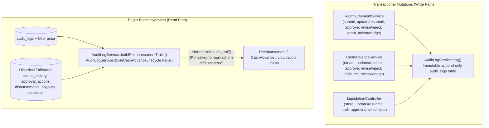

# Request View Modals — Audit Trail Section Design Specification

**Date:** Oct 22, 2026  
**Status:** Approved  
**Author:** SERMS Engineering & Architecture Council  

---

## 1. Purpose & Scope

Every financial request in SERMS—Reimbursements (including Granted Payouts), Cash Advances, and Liquidations—has a view/review modal used by Employees and Administrators. While the modals currently feature a high-level status stepper (`UnifiedRoadmapStepper` or the 4-step Reimbursement timeline), they do not display a full chronological **Audit Trail** showing every state mutation, actor name & role, timestamp, revision/rejection comments across attempts, disbursement details, field-level changes on resubmissions, and (for Admins) actor IP addresses.

This specification defines:
1. Full `AuditLogService::log()` coverage across all Reimbursements, Cash Advances, and Liquidations mutations (satisfying `AGENTS.md` Definition of Done).
2. Centralized, batch-hydrated `audit_trail` enrichment in `AuditLogService` that merges `audit_logs` records with historical/seeded fallback records (`CashAdvanceStatusHistory`, `CashAdvanceApprovalAction`, `CashAdvanceDisbursement`, `PenaltyRecord`, `Payout`, and initial submission timestamps) so every existing and new request renders a complete timeline with zero $N+1$ queries.
3. Role-based metadata filtering on the server (`ip_address` stripped for non-admin viewers) and sanitized field-level diffs (`changes`) between `before_state` and `after_state`.
4. A single reusable `<BaseAuditTrail />` component (`apps/web/src/components/base/BaseAuditTrail.vue`, compliant with `A-09` reusability rules) integrated into all 5 request/payout view surfaces:
   - `ReimbursementDetailsModal.vue`
   - `PayoutDetailsModal.vue`
   - `CashAdvanceDetailsModal.vue` (Admin & Employee views)
   - `LiquidationReviewModal.vue`
   - `LiquidationSettlementForm.vue` (when viewing an existing liquidation / cash advance trail)

---

## 2. Backend Architecture & Data Flow



### 2.1 Complete Mutation Logging (`AuditLogService::log()`)

| Domain | Service / Controller Method | `entity_type` | `action_type` |
|---|---|---|---|
| **Reimbursement** | `ReimbursementService::storeReimbursement` | `reimbursement` | `CLAIM_SUBMITTED` |
| **Reimbursement** | `ReimbursementService::updateReimbursement` (employee resubmit from `revise`) | `reimbursement` | `CLAIM_RESUBMITTED` |
| **Reimbursement** | `ReimbursementService::updateReimbursement` (pending edit / admin note) | `reimbursement` | `CLAIM_UPDATED` |
| **Reimbursement** | `ReimbursementService::approveReimbursement` *(existing)* | `reimbursement` | `CLAIM_APPROVED` |
| **Reimbursement** | `ReimbursementService::rejectReimbursement` *(existing)* | `reimbursement` | `CLAIM_REVISED` / `CLAIM_REJECTED` |
| **Reimbursement** | `ReimbursementService::grantReimbursement` *(existing)* | `reimbursement` | `CLAIM_GRANTED` |
| **Reimbursement** | `ReimbursementService::acknowledgePayout` *(existing)* | `reimbursement` | `PAYOUT_ACKNOWLEDGED` |
| **Cash Advance** | `CashAdvanceService::createAdvance` | `cash_advance` | `CASH_ADVANCE_SUBMITTED` |
| **Cash Advance** | `CashAdvanceService::updateAdvance` | `cash_advance` | `CASH_ADVANCE_RESUBMITTED` (if from `revise`) / `CASH_ADVANCE_UPDATED` |
| **Cash Advance** | `CashAdvanceService::approveAdvance` | `cash_advance` | `CASH_ADVANCE_APPROVED` |
| **Cash Advance** | `CashAdvanceService::rejectAdvance` | `cash_advance` | `CASH_ADVANCE_REVISED` / `CASH_ADVANCE_REJECTED` |
| **Cash Advance** | `CashAdvanceService::disburseAdvance` | `cash_advance` | `CASH_ADVANCE_DISBURSED` |
| **Cash Advance** | `CashAdvanceService::acknowledgeAdvance` | `cash_advance` | `CASH_ADVANCE_ACKNOWLEDGED` |
| **Liquidation** | `LiquidationController::store` *(existing)* | `liquidation` | `LIQUIDATION_SUBMITTED` |
| **Liquidation** | `LiquidationController::update` | `liquidation` | `LIQUIDATION_RESUBMITTED` (if from `revise`) / `LIQUIDATION_UPDATED` |
| **Liquidation** | `LiquidationController::audit` *(existing)* | `liquidation` | `LIQUIDATION_APPROVED` / `LIQUIDATION_REVISED` / `LIQUIDATION_REJECTED` |

### 2.2 Normalized `audit_trail` Entry Contract

Each item in the `audit_trail` array returned on `Reimbursement`, `CashAdvance`, and `Liquidation` models conforms to:

```json
{
  "id": "log-104",
  "domain": "reimbursement",
  "domain_label": "Reimbursement",
  "action_type": "CLAIM_REVISED",
  "label": "Revision Requested (Attempt 1/3)",
  "tone": "warning",
  "actor_name": "Alex Reyes",
  "actor_role": "Finance Manager",
  "ip_address": "192.168.1.10",
  "comment": "Please provide a clear photo of the OR number.",
  "changes": [
    {
      "field": "Amount",
      "before": "₱1,200.00",
      "after": "₱1,500.00"
    }
  ],
  "created_at": "2026-10-22T14:30:00.000000Z"
}
```

- **Unified Lifecycle for Cash Advance & Liquidation:** `AuditLogService::enrichCashAdvancesWithAuditTrail()` and `LiquidationController::hydrateLiquidation()` merge events for both the `CashAdvance` (`entity_type = 'cash_advance'`) and its linked `Liquidation` (`entity_type = 'liquidation'`), plus any `PenaltyRecord` entries (`OVERDUE_PENALTY`), sorted chronologically.
- **Diff Sanitization:** `AuditLogService::computeSanitizedDiff(?array $before, ?array $after)` compares whitelisted business fields (`amount`, `description`, `purpose`, `date`, `cutoff_period`, `expected_disbursement_date`, `expected_liquidation_date`, `total_expense_amount`, `outstanding_balance`, `shortfall_explanation`, `user_comment`, `payout_method`) and ignores noisy/sensitive fields (`updated_at`, `created_at`, `signature`, `granter_signature`, `employee_signature`, `id`, `user_id`).
- **Role-Based Privacy:** `ip_address` is set to `null` whenever `$includeSensitiveMeta` (`$canManage`) is `false`.

---

## 3. Frontend Architecture & UX (`<BaseAuditTrail />`)

### 3.1 Medium Date + Time Formatting (`formatDateTime`)
In `apps/web/src/utils/formatters.js`, add `formatDateTime(dateStr)`:
- Uses Medium Date Format + 12-hour time (e.g., `Oct 22, 2026, 2:30 PM`), strictly adhering to the `AGENTS.md` Medium Date Formatting Standard.

### 3.2 `<BaseAuditTrail />` Component (`apps/web/src/components/base/BaseAuditTrail.vue`)
- **Props:**
  - `entries` (`Array`, default `() => []`) — Normalized `audit_trail` entries from the record.
  - `isAdmin` (`Boolean`, default `false`) — Controls visibility of `ip_address` pill.
  - `showDomainBadge` (`Boolean`, default `false`) — Enabled on Cash Advance & Liquidation modals to distinguish `Cash Advance` vs `Liquidation` lifecycle events.
  - `initialVisibleCount` (`Number`, default `4`) — Number of entries shown before the `"Show all X events"` expander.
  - `defaultExpanded` (`Boolean`, default `true`) — Whether the accordion section starts expanded.
- **Interactive Features:**
  - **Collapsible Section Header:** Displays `Audit Trail (N)` with an event count pill, a sort-order toggle button (`Latest First ↓` / `Oldest First ↑`, defaulting to `Latest First ↓`), and an expand/collapse toggle button.
  - **Vertical Timeline Items:** Color-coded timeline node (`emerald` for approved/granted/disbursed/acknowledged/liquidated, `amber/orange` for revise/updated, `red` for rejected/penalty, `primary/slate` for submitted), Action Label, optional Domain Badge, Actor Name & Role pill, Medium Date + Time (`formatDateTime`), and Admin-only `ip_address` monospace badge.
  - **Contextual Callout:** Renders any `comment` (admin review note, rejection reason, employee note, disbursement channel/reference, or payout method) in a subtle bordered callout box (`bg-slate-50 border-slate-200`, zero `border-t-*` colored top borders per `DSD.md`).
  - **Expandable Field Diffs:** When `entry.changes?.length > 0`, displays a `"View Changes (N)"` toggle button that expands a compact before → after table (`before` in strike-through muted text, `after` in bold `text-slate-800`).

---

## 4. Verification & Testing Strategy

- **Backend Feature Tests (`apps/api/tests/Feature/RequestAuditTrailTest.php`):**
  - Verifies that Reimbursement lifecycle mutations (`store`, `update/resubmit`, `approve`, `reject/revise`, `grant`, `acknowledge`) write `audit_logs` rows and return a populated `audit_trail` array on `GET /api/serms/reimbursements` and `GET /api/serms/reimbursements/{id}`.
  - Verifies that Cash Advance + Liquidation lifecycle mutations (`store`, `approve`, `revise`, `disburse`, `acknowledge`, liquidation `store`, `update`, `audit`) write `audit_logs` rows and return a unified `audit_trail` across both entities.
  - Verifies that `ip_address` is present for Admin users and `null` for standard Employees.
  - Verifies that `changes` diffs capture business field updates (e.g., `amount`, `purpose`, `description`) and exclude base64 signatures.
- **Frontend Unit & Component Tests (Vitest):**
  - `apps/web/src/components/base/BaseAuditTrail.test.js`: Tests rendering, sort order toggle (`Latest First` vs `Oldest First`), collapse/expand, `"Show all X events"` pagination cap, expandable field diffs, and Admin-only IP display.
  - Modal integration tests in `ReimbursementDetailsModal.test.js`, `CashAdvanceDetailsModal.test.js`, and `LiquidationReviewModal.test.js`.
